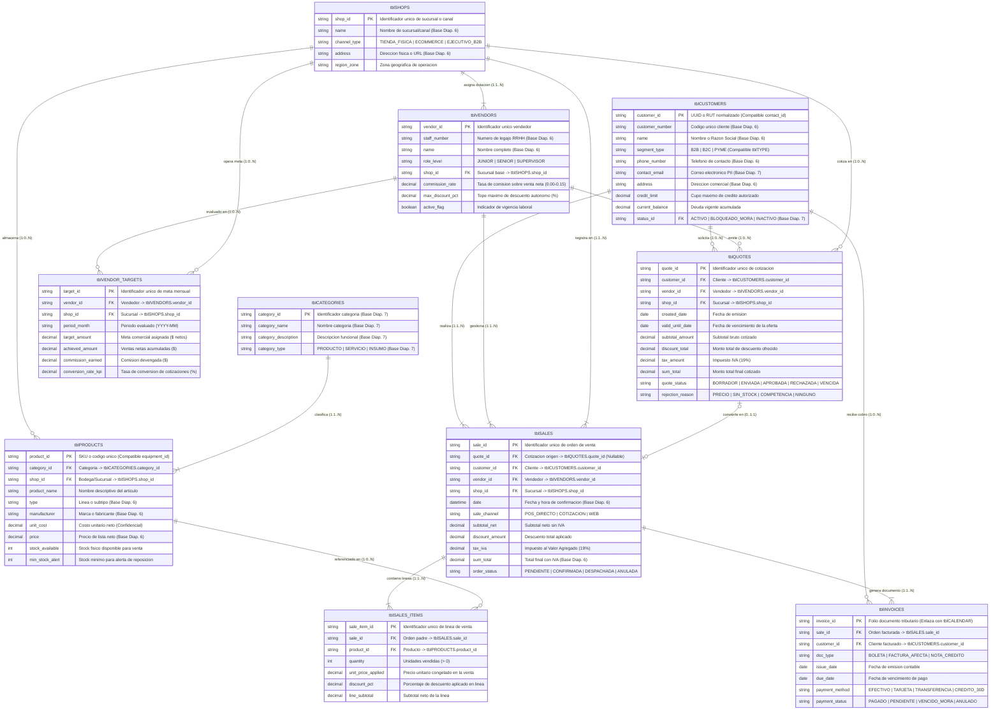

# Modelo Entidad-Relación (MER) y Compatibilidad con la Estructura Base — Módulo ERP de Ventas

- **Proyecto**: Sistema ERP Modular (Mock-up Funcional Frontend) — Área de Ventas
- **Curso**: 580211-1 Modelación de Sistemas (2026-2) — Departamento de Ingeniería Industrial, Universidad de Concepción
- **Grupo**: Grupo 21
- **Entrega**: Avance del Trabajo Final (Revisión de Repositorio — Semana del 20 de octubre / Cierre de edición: Jueves 22 de octubre a las 15:00 hrs)
- **Ubicación en el repositorio**: `specs/001-modulo-ventas/data-model.md`

## 1. Propósito y Alcance del Modelo de Datos

En cumplimiento de las instrucciones de evaluación del primer avance (*"(1) Modelo Entidad-Relación describiendo su estructura de datos y compatibilidad con la estructura base"*), este documento especifica:
1. **La arquitectura completa del Modelo Entidad-Relación (MER)** del Módulo de Ventas para una empresa comercial genérica, diseñada bajo **Tercera Forma Normal (3FN)** e implementada en sesión local (`window.localStorage`).
2. **La compatibilidad estricta de llaves primarias (`PK`) y foráneas (`FK`) con la estructura base del curso**, cubriendo tanto el esquema comercial de la **Diapositiva 6** (`Customer`, `Product`, `Shop`, `Vendor`, `Sales`) como el esquema relacional extendido de la **Diapositiva 7** (`tblCATEGORIES`, `tblSTATUS`, `tblCONTACTS`, `tblCALENDAR`) de `MDS_SDD_taller.pdf`.
3. **La descripción detallada de cada tabla y atributo, junto con la justificación metodológica** de cómo soportan las Historias de Usuario (`HU-01` a `HU-05`), las herramientas analíticas de estimación y el control de riesgos/sesgos de datos.

## 2. Compatibilidad con la Estructura Base del Curso (Diapositivas 6 y 7)

Uno de los requisitos críticos de un ERP modular es que todos los módulos compartan llaves primarias (`PK`) consistentes para operar sobre una misma base de datos sin duplicidad ni pérdida de integridad referencial. Nuestro MER garantiza **compatibilidad bidireccional** con los dos modelos base entregados en clases:

### 2.1 Mapeo con el Esquema Base Comercial (Diapositiva 6 de `MDS_SDD_taller.pdf`)

| Tabla Base (Diap. 6) | Campos Originales | Tabla en Nuestro MER | Llave Primaria (`PK`) | Cómo se Preserva la Compatibilidad y Qué se Extiende para el Módulo de Ventas |
| :--- | :--- | :--- | :--- | :--- |
| **`Customer`** | `Phone number`, `Customer number`, `Name`, `Address` | **`tblCUSTOMERS`** | `customer_id` | Conserva los 4 atributos originales exactos (`phone_number`, `customer_number`, `name`, `address`) y añade `segment_type` (`B2B`/`B2C`/`PYME`), `contact_email`, `credit_limit`, `current_balance` y `status_id` para gestionar cupos de crédito y bloqueo por mora junto a CRM y Contabilidad. |
| **`Product`** | `Price`, `Type`, `Manufacturer` | **`tblPRODUCTS`** | `product_id` | Conserva `price`, `type` y `manufacturer`, vinculándose mediante `category_id` (`FK1`) y `shop_id` (`FK2`). Añade `product_name`, `unit_cost` (para cálculo de margen bruto), `stock_available` y `min_stock_alert` para sincronización en vivo con Inventario/Bodega. |
| **`Shop`** | `Address`, `Name` | **`tblSHOPS`** | `shop_id` | Conserva `address` y `name`, añadiendo `channel_type` (`TIENDA_FISICA`, `ECOMMERCE`, `EJECUTIVO_B2B`) y `region_zone` para segmentar ventas por canal y zona geográfica. |
| **`Vendor`** | `Staff number`, `Name` | **`tblVENDORS`** | `vendor_id` | Conserva `staff_number` y `name`, agregando `shop_id` (`FK1`), `role_level` (`JUNIOR`/`SENIOR`/`SUPERVISOR`), `commission_rate`, `max_discount_pct` y `active_flag` para controlar topes de descuento y liquidar comisiones con RRHH. |
| **`Sales`** | `Product (FK)`, `Date`, `Sum total` | **`tblSALES`** + **`tblSALES_ITEMS`** | `sale_id` / `sale_item_id` | Conserva `date` y `sum_total` en la cabecera `tblSALES` (para que cualquier módulo externo que consulte `tblSALES.sum_total` obtenga el total vendido sin cambios) y desacopla los productos vendidos en la tabla detalle `tblSALES_ITEMS` (`1:N`), permitiendo múltiples artículos por venta. |

### 2.2 Mapeo de Llaves Primarias con el Esquema Relacional Extendido (Diapositiva 7 de `MDS_SDD_taller.pdf`)

Para asegurar compatibilidad con los equipos que utilicen la nomenclatura `tbl*` de la diapositiva 7 (gestión de proyectos, equipamiento, agenda y estados):

| Entidad del Esquema Extendido (Diap. 7) | Llave Primaria / Atributo de Enlace en Diap. 7 | Punto de Conexión Exacto en Nuestro MER de Ventas | Beneficio de Interconexión entre Módulos del ERP |
| :--- | :--- | :--- | :--- |
| **`tblCATEGORIES`** | `PK category_id` (`category_name`, `category_description`, `category_type`) | **`tblCATEGORIES.category_id`** → `FK1` en **`tblPRODUCTS.category_id`** | Adopta la tabla `tblCATEGORIES` con sus 4 campos idénticos, permitiendo clasificar tanto bienes físicos (`PRODUCTO`), insumos (`INSUMO`) como servicios/arriendos (`SERVICIO`). |
| **`tblSTATUS`** | `PK status_id` (`status_name`, `status_notes`) | **`tblCUSTOMERS.status_id`** y estado operativo en **`tblPRODUCTS`** / **`tblSALES`** | Estandariza los estados maestros del ERP (`ACTIVO`, `BLOQUEADO_MORA`, `INACTIVO`) mediante la llave foránea `status_id`. |
| **`tblCONTACTS`** | `PK contact_id` (`contact_email`, `FK1 type_id`) | **`tblCUSTOMERS.customer_id`** (`contact_email`, `segment_type`) | Mantiene equivalencia directa entre el directorio de contactos (`contact_email` y tipo de contacto) y el maestro de clientes comerciales. |
| **`tblCALENDAR`** | `PK calendar_id` (`calendar_date`, **`invoice_id`**, `calendar_date_confirmed`) | **`tblINVOICES.invoice_id`** (`PK` Folio de Factura) y `issue_date` / `due_date` | En la diapositiva 7, `tblCALENDAR` incluye explícitamente el campo **`invoice_id`**. Nuestra tabla **`tblINVOICES`** expone `invoice_id` como llave primaria (`PK`), permitiendo que el módulo de Calendario/Proyectos facture hitos o arriendos de equipamiento directamente a través del módulo de Ventas. |
| **`tblEQUIPMENT` / `tblHIRE_RATES`** | `PK equipment_id` / `PK hire_rate_id` (`hire_rate_rate`) | **`tblPRODUCTS.product_id`** y **`tblPRODUCTS.price`** | Permite tratar el arriendo de equipos o servicios por proyecto como ítems comercializables dentro de `tblQUOTES` y `tblSALES_ITEMS`. |

## 3. Diagrama del Modelo Entidad-Relación (Mermaid.js y Archivo `mer_ventas_erp.png`)

Además de la lámina gráfica de alta resolución `specs/001-modulo-ventas/mer_ventas_erp.png`, el siguiente diagrama `erDiagram` describe la totalidad del esquema relacional en GitHub:

## 4. Descripción de Conjuntos de Datos y Justificación Metodológica por Historia de Usuario

En cumplimiento directo del segundo criterio de la rúbrica de evaluación (*"Manejo general de historias de usuario asociadas a decisiones metodológicas y de bases de datos: descripción de estos y justificación de sus decisiones"*), se detalla cómo cada conjunto de datos responde a una decisión metodológica y a las Historias de Usuario del módulo:

| Tabla del MER | Naturaleza y Clave en `localStorage` | Historias de Usuario Asociadas | Descripción de los Datos Contenidos | Justificación Metodológica de Base de Datos |
| :--- | :--- | :--- | :--- | :--- |
| **`tblCUSTOMERS`** | Maestra Compartida (`erp_shared_customers`) | **HU-01, HU-02, HU-03, HU-04** | Identificación única (`customer_id`, `customer_number`), perfil (`name`, `segment_type`), datos de contacto PII (`phone_number`, `contact_email`, `address`) y riesgo financiero (`credit_limit`, `current_balance`, `status_id`). | Evita duplicar datos de clientes entre Ventas, CRM y Contabilidad. Incorporar `credit_limit` y `current_balance` permite validar solvencia en tiempo real antes de autorizar compras a crédito. |
| **`tblVENDORS`** | Maestra Compartida (`erp_shared_vendors`) | **HU-01, HU-02, HU-05** | Datos de personal comercial (`vendor_id`, `staff_number`, `name`, `shop_id`), jerarquía (`role_level`), comisión (`commission_rate`) y límite de descuento autónomo (`max_discount_pct`). | Parametrizar `max_discount_pct` directamente en la entidad del vendedor evita reglas fijas en el código (*hardcoding*) y permite auditar quién autorizó cada descuento. |
| **`tblSHOPS`** | Maestra Compartida (`erp_shared_shops`) | **HU-01, HU-02, HU-05** | Código de sucursal (`shop_id`), nombre (`name`), tipo de canal (`channel_type`), dirección (`address`) y zona (`region_zone`). | Permite comparar el rendimiento comercial entre canales físicos, digitales y ejecutivos B2B sin mezclar costos ni metas. |
| **`tblCATEGORIES`** | Maestra Compartida (`erp_shared_categories`) | **HU-02, HU-05** | Identificador (`category_id`), nombre (`category_name`), descripción (`category_description`) y tipo (`category_type`). | Garantiza normalización del catálogo y agrupa productos para las proyecciones estadísticas de demanda por familia. |
| **`tblPRODUCTS`** | Maestra Compartida (`erp_shared_products`) | **HU-01, HU-02, HU-03, HU-05** | SKU (`product_id`), clasificación (`category_id`, `shop_id`, `type`, `manufacturer`), valoración (`unit_cost`, `price`) e inventario físico (`stock_available`, `min_stock_alert`). | Incluir `unit_cost` junto a `price` es metodológicamente indispensable para calcular el **margen de contribución real** tras descuentos; `stock_available` previene ventas de productos agotados. |
| **`tblQUOTES`** | Transaccional Ventas (`erp_sales_quotes`) | **HU-01, HU-05** | Cabecera de cotización (`quote_id`, `customer_id`, `vendor_id`, `shop_id`), vigencia (`created_date`, `valid_until_date`), montos (`subtotal_amount`, `discount_total`, `tax_amount`, `sum_total`), estado (`quote_status`) y motivo de rechazo (`rejection_reason`). | Separar `tblQUOTES` de `tblSALES` impide que un presupuesto no confirmado rebaje stock o infle las ventas contables. Además, `rejection_reason` captura las ventas perdidas por `SIN_STOCK` para corregir el **sesgo de supervivencia**. |
| **`tblSALES`** | Transaccional Ventas (`erp_sales_orders`) | **HU-01, HU-02, HU-03, HU-04, HU-05** | Orden de venta confirmada (`sale_id`), trazabilidad a preventa (`quote_id`), referencias (`customer_id`, `vendor_id`, `shop_id`), fecha (`date`), canal (`sale_channel`), desglose tributario (`subtotal_net`, `discount_amount`, `tax_iva`, `sum_total`) y estado (`order_status`). | Actúa como entidad puente del ERP: consolida el monto total (`sum_total`) requerido por el MER base del curso y separa el monto neto del IVA (19%) para reportes financieros exactos. |
| **`tblSALES_ITEMS`** | Transaccional Ventas (`erp_sales_items`) | **HU-01, HU-02, HU-05** | Detalle por línea (`sale_item_id`, `sale_id`, `product_id`), cantidad (`quantity`), precio congelado (`unit_price_applied`), porcentaje de descuento (`discount_pct`) y subtotal (`line_subtotal`). | Resuelve la cardinalidad `N:M` entre órdenes y productos (3FN). Guardar `unit_price_applied` asegura **inmutabilidad histórica**: si un producto sube de precio mañana en `tblPRODUCTS`, las facturas pasadas no se alteran. |
| **`tblINVOICES`** | Transaccional Ventas ↔ Contabilidad (`erp_sales_invoices`) | **HU-03, HU-04** | Folio tributario (`invoice_id`), orden asociada (`sale_id`), cliente (`customer_id`), tipo (`BOLETA`, `FACTURA_AFECTA`, `NOTA_CREDITO`), fechas (`issue_date`, `due_date`), medio de pago (`payment_method`) y estado (`payment_status`). | Desacopla el flujo logístico del pedido (`order_status`) del flujo financiero de cobro (`payment_status`), permitiendo gestionar pagos a 30 días y reversar ventas mediante Notas de Crédito. |
| **`tblVENDOR_TARGETS`** | Analítica Ventas ↔ RRHH (`erp_sales_vendor_targets`) | **HU-05** | Meta por período (`target_id`, `vendor_id`, `shop_id`, `period_month`), cuota asignada (`target_amount`), logro real (`achieved_amount`), comisión (`commission_earned`) y conversión (`conversion_rate_kpi`). | Permite evaluar equitativamente a cada vendedor frente a la realidad de su sucursal y cartera, evitando el sesgo de premiar únicamente el volumen bruto facturado. |

## 5. Reglas de Integridad Referencial y Transaccionalidad en Frontend (`localStorage`)

Dado que el mock-up funcional se ejecuta en el navegador sin un servidor SQL externo, la capa de datos (`StorageService`) implementa cuatro guardrails automáticos sobre `window.localStorage`:

1. **Integridad de Entidad (`PK_UNIQUE`)**: Validación de unicidad estricta de llaves primarias antes de insertar en cualquier colección JSON.
2. **Integridad Referencial (`FK_EXISTS`)**: Bloqueo de inserción en `tblQUOTES`, `tblSALES`, `tblSALES_ITEMS`, `tblINVOICES` y `tblVENDOR_TARGETS` si alguna llave foránea (`customer_id`, `vendor_id`, `shop_id`, `product_id`, `sale_id`) no existe en su tabla maestra.
3. **Borrado Lógico Preventivo (`SOFT_DELETE_ONLY`)**: Prohibición de eliminar físicamente registros maestros (`tblCUSTOMERS`, `tblPRODUCTS`, `tblVENDORS`) que tengan transacciones históricas asociadas; solo se permite cambiar `status_id = 'INACTIVO'` o `active_flag = false`.
4. **Transacción Atómica de Confirmación y Anulación**:
   - Al **confirmar una venta**: se valida `quantity <= stock_available` y `current_balance + sum_total <= credit_limit`; luego se rebaja el stock en `tblPRODUCTS`, se incrementa el saldo en `tblCUSTOMERS` (si es a crédito), se emite el folio en `tblINVOICES` y se actualiza la meta en `tblVENDOR_TARGETS`.
   - Al **emitir una Nota de Crédito (Anulación)**: se cambia `tblSALES.order_status` a `ANULADA`, se restituye el stock a `tblPRODUCTS.stock_available` y se descuenta la deuda en `tblCUSTOMERS.current_balance`.

## 6. Referencias Bibliográficas y Técnicas

1. **Microsoft Developer Blog** (2025). *Spec-Driven Development: AI-Native Engineering*. Disponible en: [https://developer.microsoft.com/blog/spec-driven-development-ai-native-engineering/](https://www.google.com/search?q=https%3A%2F%2Fdeveloper.microsoft.com%2Fblog%2Fspec-driven-development-ai-native-engineering%2F)
2. **GitHub Open Source** (2025). *Spec Kit: Toolkit for Spec-Driven Development*. Disponible en: [https://github.com/github/spec-kit](https://www.google.com/search?q=https%3A%2F%2Fgithub.com%2Fgithub%2Fspec-kit)
3. **Elmasri, R., & Navathe, S. B.** (2016). *Fundamentals of Database Systems* (7th ed.). Pearson. (Capítulos 3, 7 y 10: Diseño Conceptual MER, Restricciones de Integridad Referencial y Tercera Forma Normal).
4. **Monk, E., & Wagner, B.** (2013). *Concepts in Enterprise Resource Planning* (4th ed.). Cengage Learning. (Capítulo 3: Marketing and Sales ERP Modules & Order-to-Cash Integration).
5. **Caro, J. C., Astroza, S., & Catalán, P.** (2026). *Presentación SDD y Pauta de Trabajo Grupal: Modelación de Sistemas (580211-1)*. Departamento de Ingeniería Industrial, Universidad de Concepción.
