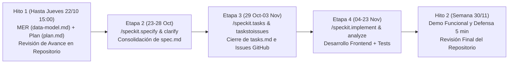

# Plan de Trabajo y Diseño del Módulo ERP de Ventas (`plan.md`)

- **Proyecto**: Sistema ERP Modular (Mock-up Funcional Frontend) — Área de Ventas
- **Curso**: 580211-1 Modelación de Sistemas (2026-2) — Departamento de Ingeniería Industrial, Universidad de Concepción
- **Grupo**: Grupo 21
- **Entrega**: Avance del Trabajo Final (Revisión de Repositorio — Semana del 20 de octubre / Cierre de edición: Jueves 22 de octubre a las 15:00 hrs)
- **Ubicación en el repositorio**: `specs/001-modulo-ventas/plan.md`

## 1. Propósito y Alcance del Documento (`plan.md`)

En cumplimiento directo de los requisitos indicados por el equipo docente para la primera revisión de avance (*"Deben tener: (1) Modelo Entidad-Relación describiendo su estructura de datos y compatibilidad con la estructura base, (2) archivo de plan de trabajo (plan.md) que describa su módulo en específico. Se evaluará en base a la rúbrica, tanto la completitud como complejidad de la herramienta propuesta"*), este documento presenta de forma íntegra y autocontenida:

1. **La descripción completa del problema operacional y la solución propuesta** para el Módulo de Ventas de una empresa comercial genérica (criterio 3 de la rúbrica).
2. **La completitud y complejidad técnica de la herramienta propuesta (Compromiso de MVP)**, detallando sus menús, reglas de negocio transaccionales, arquitectura de interconexión frontend (`localStorage`) y algoritmos cuantitativos de análisis y proyección de demanda.
3. **El manejo de Historias de Usuario asociadas a decisiones metodológicas y de base de datos** (criterio 2 de la rúbrica).
4. **La descripción exhaustiva de los potenciales usuarios, el manejo de riesgos de datos sensibles y la mitigación innovadora de sesgos estadísticos y operacionales** (criterio 5 de la rúbrica).
5. **El Plan de Trabajo secuencial** para construir posteriormente los archivos `spec.md`, `tasks.md` y la implementación del código rumbo a la entrega final del 30 de noviembre.

## 2. Claridad del Problema y Solución Propuesta para el Módulo de Ventas

### 2.1 Diagnóstico del Problema en el Área de Ventas

En empresas comercializadoras de bienes o servicios (tanto en modelos B2B como B2C o mixtos), cuando el área comercial opera con herramientas desconectadas del resto de la organización se producen cuatro fallas estructurales que afectan la rentabilidad y la experiencia del cliente:

1. **Sobreventa y Quiebres de Stock por Asimetría de Información**: Los ejecutivos de ventas comprometen pedidos o aprueban cotizaciones sin conocer el stock real disponible en bodega (`stock_available`), generando órdenes incumplibles, retrasos en entregas y pérdida de clientes.
2. **Erosión del Margen Comercial y Exposición a Incobrabilidad**: Otorgar descuentos manuales sin topes jerárquicos reduce la rentabilidad por debajo del costo de reposición (`unit_cost`), mientras que autorizar ventas a plazo sin verificar en vivo el cupo de crédito disponible (`credit_limit - current_balance`) ni el estado de morosidad del cliente incrementa la cartera vencida de Finanzas.
3. **Fricción Operativa entre Ventas, Despacho y Contabilidad**: La falta de generación automática de documentos tributarios (`Boleta`, `Factura Afecta`, `Nota de Crédito`) obliga a redigitar las órdenes de venta cerradas, produciendo descuadres entre el inventario físico devuelto y los saldos contables anulados.
4. **Toma de Decisiones Sesgada por Datos Incompletos**: La gerencia comercial suele proyectar la demanda futura mirando solo las ventas facturadas (ignorando la demanda perdida cuando no hubo stock) y evalúa a los vendedores únicamente por el monto bruto vendido, sin ponderar el margen defendido ni las diferencias de tamaño de cartera entre sucursales.

### 2.2 Solución Propuesta y Complejidad de la Herramienta (Compromiso de MVP)

Proponemos el diseño e implementación de un **Módulo ERP de Ventas de Ciclo Completo (*Lead-to-Cash*)**, desarrollado como una aplicación web **100% Frontend** (`HTML5`, `CSS3` y `JavaScript ES6+ Modular` con persistencia relacional simulada en `window.localStorage`), interconectada de forma nativa con los módulos de **Inventario/Bodega**, **Clientes (CRM)**, **Contabilidad/Finanzas** y **Recursos Humanos**.

Para asegurar un alto estándar de **completitud y complejidad funcional**, la herramienta integra cuatro subsistemas interactivos dentro del formato exigido por la cátedra:

| Componente del Producto | Descripción Funcional y Complejidad Técnica de la Herramienta Propuesta | Entidades del MER Involucradas |
| :--- | :--- | :--- |
| **1. Página Principal (Dashboard Ejecutivo y Simulador de Demanda)** | • Tarjetas de KPIs dinámicos en tiempo real: *Ventas Netas ($)*, *Margen de Contribución ($ y %)*, *Ticket Promedio*, *Tasa de Conversión de Cotizaciones (%)* y *Demanda Insatisfecha por Quiebre de Stock*. • Gráficos interactivos en Canvas/SVG comparando Ventas vs. Metas por sucursal (`tblSHOPS`) y evolución mensual. • Selector global de contexto ERP (simulador de Rol activo `JUNIOR`/`SENIOR`/`SUPERVISOR` y selector de Sucursal). | `tblSALES`, `tblSALES_ITEMS`, `tblQUOTES`, `tblPRODUCTS`, `tblVENDOR_TARGETS`, `tblSHOPS` |
| **2. Menús de Operación Transaccional (Preventa, POS/Órdenes y Facturación)** | • **Submódulo de Cotizaciones (`tblQUOTES`)**: Constructor de presupuestos multiproducto con cálculo de vigencia, conversión automática en 1 clic a Orden de Venta y captura obligatoria de causal de rechazo (`PRECIO`, `SIN_STOCK`, `COMPETENCIA`). • **Submódulo Punto de Venta (POS) y Órdenes (`tblSALES` + `tblSALES_ITEMS`)**: Validador síncrono de stock (`quantity <= stock_available`), control automático de tope de descuento según rol del vendedor (`max_discount_pct`), congelamiento de precio histórico (`unit_price_applied`) y rebaja atómica de inventario. • **Submódulo de Facturación, Crédito y Devoluciones (`tblINVOICES`)**: Generación automática de `BOLETA` o `FACTURA_AFECTA` (desglosando Neto e IVA 19%), bloqueo preventivo si el cliente supera su `credit_limit` o está en estado `BLOQUEADO_MORA`, y motor de anulación mediante `NOTA_CREDITO` que restituye el stock a bodega y rebaja la deuda del cliente. | `tblQUOTES`, `tblSALES`, `tblSALES_ITEMS`, `tblINVOICES`, `tblPRODUCTS`, `tblCUSTOMERS`, `tblVENDORS` |
| **3. Menú de Cartera 360° y Evaluación de Vendedores** | • **Ficha 360° de Clientes (`tblCUSTOMERS`)**: Historial consolidado de cotizaciones, órdenes y facturas, semáforo visual de utilización de línea de crédito y enmascaramiento de datos sensibles (PII). • **Tablero de Metas y Comisiones (`tblVENDOR_TARGETS`)**: Liquidación automática de comisiones devengadas y cálculo del **Índice de Desempeño de Vendedor ($IDV$)** ajustado por cuota, margen y conversión. | `tblCUSTOMERS`, `tblVENDORS`, `tblVENDOR_TARGETS`, `tblSHOPS` |
| **4. Herramientas Analíticas de Estimación y Auditoría de Datos** | • **Motor de Proyección de Ventas en JavaScript**: Implementa dos modelos matemáticos comparables en pantalla: **Media Móvil Ponderada de 3 períodos corregida por quiebres de stock (WMA-3)** y **Regresión Lineal por Mínimos Cuadrados Ordinarios (OLS) con filtro automático de valores atípicos ($\pm 2\sigma$)**. • **Utilidad de Portabilidad y Resiliencia**: Exportación/importación de instantáneas `.json`, restaurador de datos semilla (*Seed Reset*) y validador de llaves primarias/foráneas (`DataIntegrityGuard`). | Todas las 10 tablas del MER en `window.localStorage` |

## 3. Historias de Usuario Asociadas a Decisiones Metodológicas y de Base de Datos

Para garantizar trazabilidad total entre las necesidades del usuario y el diseño del Modelo Entidad-Relación (`data-model.md`), nuestro módulo se estructura sobre **5 Historias de Usuario épicas** que guiarán la posterior generación de `spec.md` y `tasks.md`:

| ID | Historia de Usuario (Estructura Rol / Acción / Beneficio) | Decisión Metodológica y Regla de Negocio | Decisión de Base de Datos en el MER (`data-model.md`) |
| :--- | :--- | :--- | :--- |
| **HU-01** | **Como** Ejecutivo de Ventas, **quiero** emitir cotizaciones multiproducto con fecha de validez, registrar el motivo si son rechazadas y convertirlas en Orden de Venta al aprobarse, **para** agilizar el cierre comercial y medir la demanda no concretada. | Desacoplar la etapa de preventa de la venta confirmada para no comprometer stock físico ni devengar impuestos hasta la aceptación formal del cliente. | Creación de la tabla **`tblQUOTES`** (`quote_id` PK) vinculada opcionalmente a **`tblSALES`** (`quote_id` FK1 nullable, cardinalidad `0..1:1`) e inclusión del atributo `rejection_reason`. |
| **HU-02** | **Como** Ejecutivo de Ventas, **quiero** registrar órdenes de venta validando en vivo el stock disponible en bodega y mi porcentaje máximo de descuento permitido, **para** evitar vender productos agotados y proteger el margen de la empresa. | Normalizar la orden de venta en cabecera y detalle (3FN), congelar el precio unitario vigente al momento de la transacción y parametrizar los permisos de descuento según el cargo del vendedor. | Separación en **`tblSALES`** (cabecera con `sum_total`) y **`tblSALES_ITEMS`** (detalle `1:N` con `unit_price_applied`), lectura de `stock_available` y `unit_cost` en **`tblPRODUCTS`**, y validación contra `max_discount_pct` en **`tblVENDORS`**. |
| **HU-03** | **Como** usuario comercial o contable, **quiero** que toda venta confirmada emita su documento tributario validando el cupo crediticio del cliente y permita anularse mediante Nota de Crédito, **para** mantener cuadradas las cuentas por cobrar y el inventario. | Implementar atomicidad transaccional en el frontend: una venta a plazo solo se confirma si el saldo resultante no supera el límite de crédito, y toda anulación debe revertir simultáneamente el stock y la deuda. | Creación de **`tblINVOICES`** (`invoice_id` PK compatible con `tblCALENDAR` del taller) e incorporación de `credit_limit`, `current_balance` y `status_id` en **`tblCUSTOMERS`**. |
| **HU-04** | **Como** Ejecutivo de Ventas, **quiero** consultar la ficha integral de cada cliente con su segmento, cupo disponible e historial de transacciones, **para** personalizar la atención y prevenir ventas a clientes bloqueados por mora. | Centralizar la llave primaria `customer_id` como eje transversal entre preventa, venta y facturación, aplicando control de privacidad sobre los campos de contacto. | Relación `1:N` desde **`tblCUSTOMERS`** hacia **`tblQUOTES`**, **`tblSALES`** y **`tblINVOICES`**, y enlace con estados maestros (`status_id`). |
| **HU-05** | **Como** Jefe Comercial, **quiero** contar con un Dashboard que calcule KPIs de rentabilidad, proyecte la demanda futura sin sesgos y liquide las comisiones de los vendedores según el cumplimiento de sus metas, **para** tomar decisiones basadas en datos. | Evaluar el rendimiento comercial mediante indicadores compuestos (volumen, margen y conversión) y proyectar la demanda combinando ventas reales con demanda insatisfecha por falta de stock. | Creación de **`tblVENDOR_TARGETS`** (`target_id` PK, `vendor_id` FK1, `shop_id` FK2) y cruce analítico entre `tblSALES_ITEMS`, `tblPRODUCTS` y `tblQUOTES`. |

## 4. Método de Análisis, Variables Críticas y Herramientas de Estimación

### 4.1 Variables Críticas del Módulo

1. **Ventas Netas Efectivas ($V_{\text{neto}}$)**: Suma de `tblSALES.subtotal_net` excluyendo órdenes con `order_status = 'ANULADA'`.
2. **Margen de Contribución Bruto ($M_b$ y $\%M_b$)**:
   $$M_b = \sum_{i \in \text{Items}} \left( \text{unit\_price\_applied}_i \times \left(1 - \frac{\text{discount\_pct}_i}{100}\right) - \text{unit\_cost}_i \right) \times \text{quantity}_i$$
3. **Tasa de Conversión de Cotizaciones ($TC$)**:
   $$TC = \frac{\text{Cotizaciones con } \texttt{quote\_status = 'APROBADA'}}{\text{Total de Cotizaciones Cerradas (\texttt{APROBADA} + \texttt{RECHAZADA} + \texttt{VENCIDA})}} \times 100$$
4. **Demanda Real Ajustada por Quiebre de Stock ($D_t^*$)**:
   $$D_t^* = Q_{\text{vendida}, t} + Q_{\text{cotizada no vendida por } \texttt{SIN\_STOCK}, t}$$
5. **Índice Compuesto de Desempeño de Vendedor ($IDV$)**:
   $$IDV = 0.50 \left(\frac{\text{achieved\_amount}}{\text{target\_amount}}\right) + 0.30 \left(\frac{\%M_{b, \text{vendedor}}}{\%M_{b, \text{meta}}}\right) + 0.20 \left(\frac{TC_{\text{vendedor}}}{TC_{\text{meta}}}\right)$$

### 4.2 Herramientas Cuantitativas de Estimación de Ventas ($\hat{Y}_{t+1}$)

El módulo implementa en `src/js/analytics.js` dos herramientas matemáticas complementarias para estimar las ventas del período siguiente ($t+1$):

1. **Media Móvil Ponderada de 3 Períodos con Corrección de Stock (WMA-3)**:
   $$\hat{Y}_{t+1}^{\text{WMA}} = 0.50 \cdot D_t^* + 0.30 \cdot D_{t-1}^* + 0.20 \cdot D_{t-2}^*$$
   *Justificación*: Pondera con mayor fuerza el comportamiento reciente del mercado y corrige la subestimación causada por quiebres puntuales de inventario al utilizar la demanda ajustada $D_t^*$.
2. **Regresión Lineal Simple por Mínimos Cuadrados Ordinarios (OLS) con Filtro de Atípicos ($\pm 2\sigma$)**:
   $$\hat{Y}(x) = \beta_0 + \beta_1 x, \quad \beta_1 = \frac{\sum_{t=1}^n (t - \bar{t})(Y_t - \bar{Y})}{\sum_{t=1}^n (t - \bar{t})^2}, \quad \beta_0 = \bar{Y} - \beta_1 \bar{t}$$
   *Justificación*: Captura la tendencia estructural de crecimiento o contracción del negocio. Antes de calcular $\beta_0$ y $\beta_1$, el algoritmo detecta pedidos corporativos extraordinarios cuyo valor supere $\mu_Y + 2\sigma_Y$ y los recorta al percentil superior (winsorización), evitando proyectar compras irreales para el mes siguiente.

## 5. Descripción de Potenciales Usuarios, Riesgos de Datos Sensibles y Mitigación de Sesgos

### 5.1 Perfiles de Usuarios Potenciales e Interconexión ERP

| Perfil de Usuario | Interacción Rutinaria con el Módulo | Nivel de Acceso a Datos y Reglas de Control |
| :--- | :--- | :--- |
| **Ejecutivo de Ventas Junior (`JUNIOR`)** | Emisión de cotizaciones, consulta de catálogo/stock y registro de ventas en mostrador o terreno. | Descuento autónomo máximo de **5%**. Sin acceso a `unit_cost` de productos ni a comisiones de otros vendedores. |
| **Ejecutivo de Ventas Senior (`SENIOR`)** | Gestión de cuentas clave (`B2B`/`PYME`), conversión de cotizaciones y seguimiento de cartera asignada. | Descuento autónomo máximo de **12%**. Visualiza el estado crediticio de sus clientes pero no puede modificar `credit_limit`. |
| **Jefe / Supervisor Comercial (`SUPERVISOR`)** | Monitoreo de Dashboard, autorización de descuentos excepcionales (hasta **25%**), emisión de Notas de Crédito, fijación de metas (`tblVENDOR_TARGETS`) y uso del simulador de proyecciones. | Acceso completo a costos unitarios (`unit_cost`), márgenes de contribución, auditoría de sesiones y exportación de respaldos `.json`. |
| **Usuarios de Módulos Externos (Bodega / Contabilidad / CRM / RRHH)** | Consulta sincronizada a través de `localStorage` del stock descontado (`tblPRODUCTS`), facturas emitidas (`tblINVOICES`), historial de clientes (`tblCUSTOMERS`) y comisiones (`tblVENDOR_TARGETS`). | Interacción gobernada por el contrato JSON compartido (`erp_shared_*`) y validación estricta de llaves foráneas (`FK`). |

### 5.2 Manejo de Riesgos de Datos Sensibles y Seguridad en Sesión Local

1. **Protección de Datos Personales Identificables (PII)**: En cumplimiento de los principios de la Ley 19.628 sobre Protección de la Vida Privada, los atributos sensibles de `tblCUSTOMERS` (`customer_number`/RUT, `phone_number`, `contact_email` y `address`) cuentan con una función de **enmascaramiento dinámico** en pantalla (`c***@australspa.cl`, `+56 9 **** 5500`) cuando el sistema se encuentra en modo de vista general o demostración pública.
2. **Segregación de Datos Financieros Confidenciales**: El atributo `tblPRODUCTS.unit_cost` (secreto comercial de costos de adquisición) y las remuneraciones variables en `tblVENDOR_TARGETS.commission_earned` se ocultan en el DOM para roles no supervisores.
3. **Mitigación de Riesgo de Pérdida o Corrupción en `localStorage`**: Dado que el almacenamiento local del navegador es vulnerable a borrados de caché o ediciones manuales en *DevTools*, el módulo incluye un verificador de esquema al inicio (`StorageService.verifyIntegrity()`) y un botón de exportación/importación cifrada o estructurada en `.json`.
4. **Sanitización contra Inyección XSS**: Todos los campos de entrada libre se procesan mediante asignación segura de texto (`textContent`) y validación de expresiones regulares antes de persistirse.

### 5.3 Mitigación Innovadora de Sesgos Asociados a los Datos y su Uso

El diseño del módulo aborda explícitamente cuatro sesgos críticos que suelen distorsionar la analítica en sistemas ERP comerciales:

1. **Sesgo de Supervivencia (*Survivorship Bias*)**:
   - *Problema*: Si solo se registran las ventas exitosas (`tblSALES`), los productos que quedaron sin stock (`stock_available = 0`) parecen tener "baja demanda", induciendo a Compras a reducir aún más su reposición.
   - *Mitigación*: Al registrar en `tblQUOTES` las cotizaciones rechazadas con `rejection_reason = 'SIN_STOCK'`, el sistema contabiliza la demanda latente no atendida y la suma en el modelo WMA-3 ($D_t^*$).
2. **Sesgo de Asignación de Cartera y Sucursal en Evaluación de Personal**:
   - *Problema*: Premiar únicamente el monto bruto vendido (`sum_total`) favorece estructuralmente a los vendedores asignados al canal mayorista (`EJECUTIVO_B2B`) o a la casa matriz frente a sucursales periféricas.
   - *Mitigación*: El Índice $IDV$ en `tblVENDOR_TARGETS` normaliza el desempeño midiendo el cumplimiento porcentual sobre la meta propia de su sucursal, el margen defendido (penalizando a quien vende solo a costa de regalar descuentos) y la tasa de conversión.
3. **Sesgo de Sensibilidad a Valores Extremos (*Outlier Bias*)**:
   - *Problema*: Una venta corporativa única a fin de trimestre sesga al alza la regresión lineal simple, generando sobreproducción o sobrecompra el mes siguiente.
   - *Mitigación*: El módulo `analytics.js` aplica detección automática a $\pm 2\sigma$ y muestra en el gráfico ambas curvas (*Proyección Bruta* vs. *Proyección Ajustada sin Atípicos*).
4. **Sesgo de Descuento Discrecional**:
   - *Problema*: Sin controles sistémicos, los descuentos se otorgan por cercanía subjetiva o presión del comprador en lugar de criterios comerciales objetivos.
   - *Mitigación*: Los topes de descuento están restringidos por rol (`max_discount_pct`) y vinculados al segmento objetivo del cliente (`B2B`, `PYME`, `B2C`).

## 6. Plan de Trabajo Secuencial hacia la Entrega Final (Octubre – Noviembre 2026)

Siguiendo el flujo de trabajo de **GitHub Spec Kit** (diapositivas 4 y 9 de `MDS_SDD_taller.pdf`), una vez consolidados el **MER (`data-model.md`)** y este **Plan de Trabajo (`plan.md`)** para la revisión de la semana del 20 de octubre, el equipo ejecutará las siguientes etapas:

### 6.1 Cronograma de Ejecución y Distribución Grupal

| Etapa | Ventana de Fechas | Actividades Clave y Comandos SpecKit | Entregable Verificable en el Repositorio `Grupo-21` |
| :--- | :--- | :--- | :--- |
| **Etapa 1: Modelo de Datos y Plan de Trabajo (Avance Actual)** | **13 Oct – 22 Oct (15:00 hrs)** | Diseño del MER de 10 tablas compatible con las estructuras base del taller (`data-model.md` + `mer_ventas_erp.png`), definición de principios (`constitution.md`) y redacción completa de este plan (`plan.md` + `README.md`). | **Revisión Intermedia del Repositorio (10% de la nota final)**. |
| **Etapa 2: Creación y Cierre de Especificaciones (`spec.md`)** | **23 Oct – 28 Oct** | Incorporación del feedback docente de la revisión de avance; ejecución de `/speckit.specify` y `/speckit.clarify` para formalizar los escenarios *Given/When/Then* de `HU-01` a `HU-05` y los casos borde (`EC-01` a `EC-05`). | Archivo `specs/001-modulo-ventas/spec.md` definitivo y validado contra las llaves del MER. |
| **Etapa 3: Desglose de Tareas y Apertura de Issues (`tasks.md`)** | **29 Oct – 03 Nov** | Ejecución de `/speckit.tasks` y `/speckit.taskstoissues` para dividir la construcción en tareas atómicas paralelizables y publicarlas como Issues en GitHub asignados equitativamente a cada integrante. | Archivo `specs/001-modulo-ventas/tasks.md` definitivo y tablero de Issues activo en GitHub. |
| **Etapa 4: Implementación Frontend y Pruebas de Casos Borde** | **04 Nov – 23 Nov** | *(Considerando pausa de preparación para el Certamen 2 del 10 de noviembre)*: • **Sprint 4.1 (04-09 Nov)**: Implementación de `storage.js`, datos semilla y validador `PK/FK`. • **Sprint 4.2 (11-17 Nov)**: Implementación de vistas HTML/CSS y flujos `HU-01`, `HU-02` y `HU-03` (Cotizaciones, POS/Stock y Facturación). • **Sprint 4.3 (18-23 Nov)**: Implementación de `analytics.js` (WMA-3 y OLS), `HU-04`, `HU-05` y suite de tests (`tests/sales-validation.test.js`). | Código fuente completo en `/src` (`index.html`, `styles.css`, `storage.js`, `models.js`, `analytics.js`, `app.js`) ejecutable con 1 clic en el navegador. |
| **Etapa 5: Auditoría de Calidad y Preparación de Defensa Final** | **24 Nov – 30 Nov** | Ejecución de `/speckit.analyze`, actualización del Anexo de Uso de IA y ensayo grupal de la presentación de 5 minutos (preparando a todos los integrantes para la elección aleatoria del expositor). | **Presentación Final (10%) y Revisión Final del Repositorio (10%)**. |

### 6.2 Protocolo de Trabajo Colaborativo y Co-Evaluación Vinculante

Para asegurar que todos los integrantes del **Grupo 21** dominen la arquitectura del sistema y mantengan una contribución equitativa verificable en el repositorio (evitando penalizaciones en la co-evaluación vinculante):
1. **Trabajo basado en Issues y Pull Requests / Commits Individuales**: Cada integrante asume la responsabilidad directa de un subsistema del MER y registra sus avances mediante commits desde su cuenta individual en GitHub.
2. **Revisión Cruzada Pre-Certamen y Pre-Entrega**: Ningún cambio al modelo de datos se realiza directamente en el código JS sin actualizar primero `data-model.md` y `spec.md`, manteniendo la trazabilidad exigida por Spec-Driven Development.

## 7. Referencias Bibliográficas y Técnicas

1. **Microsoft Developer Blog** (2025). *Spec-Driven Development: AI-Native Engineering*. Disponible en: [https://developer.microsoft.com/blog/spec-driven-development-ai-native-engineering/](https://www.google.com/search?q=https%3A%2F%2Fdeveloper.microsoft.com%2Fblog%2Fspec-driven-development-ai-native-engineering%2F)
2. **GitHub Open Source** (2025). *Spec Kit: Toolkit for Spec-Driven Development*. Disponible en: [https://github.com/github/spec-kit](https://www.google.com/search?q=https%3A%2F%2Fgithub.com%2Fgithub%2Fspec-kit)
3. **Elmasri, R., & Navathe, S. B.** (2016). *Fundamentals of Database Systems* (7th ed.). Pearson.
4. **Monk, E., & Wagner, B.** (2013). *Concepts in Enterprise Resource Planning* (4th ed.). Cengage Learning.
5. **Hyndman, R. J., & Athanasopoulos, G.** (2021). *Forecasting: Principles and Practice* (3rd ed.). OTexts. (Métodos de suavizamiento, medias móviles ponderadas y regresión con tratamiento de valores atípicos).
6. **Caro, J. C., Astroza, S., & Catalán, P.** (2026). *Material de cátedra y Pauta de Evaluación: Modelación de Sistemas (580211-1)*. Departamento de Ingeniería Industrial, Universidad de Concepción.
