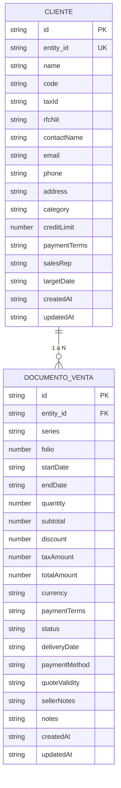
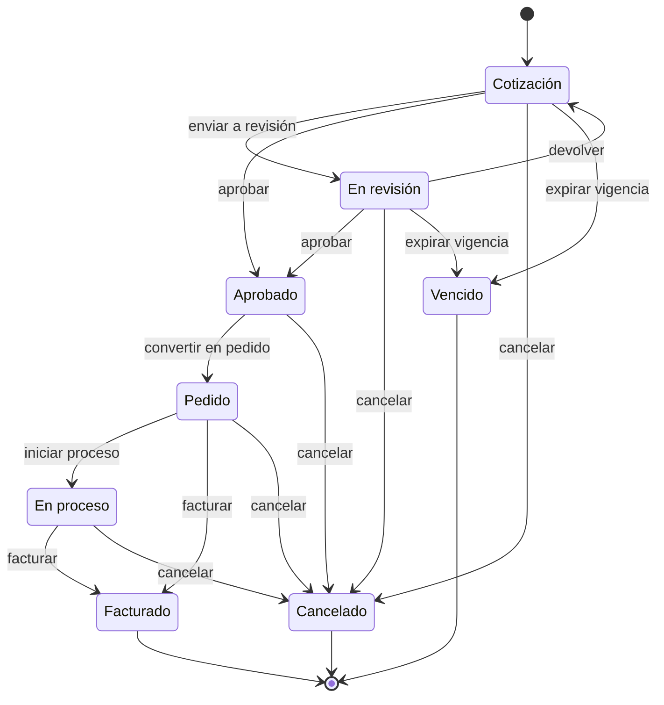

# Modelo de Datos: Módulo de Ventas

El módulo de Ventas reutiliza las entidades base `Entity` y `Document` del ERP, adaptándolas como `Cliente` y `Documento de Venta`. La Cotización y el Pedido de Venta son el mismo documento en distintos estados del ciclo de vida, no entidades separadas.

## Entidad: Cliente

Representa a una persona natural o jurídica con la que se realiza una operación comercial. Es la adaptación de `Entity` e incorpora identidad fiscal, datos de contacto, condiciones comerciales y vendedor asignado.

### Campos base heredados

| Campo | Tipo | Descripción | Restricciones |
|---|---|---|---|
| id | string | Identificador interno único del cliente | Obligatorio, generado automáticamente |
| entity_id | string | Identificador público usado para vincular documentos de venta al cliente | Obligatorio, generado automáticamente, único |
| name | string | Nombre o razón social del cliente | Obligatorio, no vacío |
| code | string | Código o clave de negocio del cliente (p. ej., CLI-001) | Obligatorio, no vacío |
| taxId | string | Identificación fiscal canónica del cliente (RFC o NIT) | Opcional; se almacena recortada cuando se proporciona |
| email | string | Correo electrónico principal de contacto | Opcional; debe tener formato de correo válido si se proporciona |
| phone | string | Teléfono de contacto | Opcional |
| address | string | Dirección fiscal o comercial | Opcional |
| category | string | Segmento o clasificación comercial (p. ej., mayorista, minorista) | Opcional |
| description | string | Descripción corta o notas generales del cliente | Opcional |
| targetDate | string | Fecha objetivo para seguimiento o revisión de crédito en formato YYYY-MM-DD | Opcional, debe ser una fecha de calendario válida si se proporciona |
| creditLimit | number | Límite de crédito otorgado al cliente en la moneda configurada | Opcional, debe ser un número no negativo |
| paymentTerms | string | Condiciones de pago acordadas con el cliente | Opcional; en el perfil de Ventas debe pertenecer a las opciones configuradas |
| createdAt | string | Marca de tiempo de cuándo se creó el cliente | Obligatorio |
| updatedAt | string | Marca de tiempo de la última actualización del cliente | Obligatorio |

### Campos personalizados del perfil de Ventas

| Campo | Tipo | Descripción | Restricciones |
|---|---|---|---|
| rfcNit | string | RFC/NIT mostrado en la interfaz comercial como alias controlado de `taxId` | Opcional; texto recortado; si `taxId` y `rfcNit` coexisten deben representar el mismo valor normalizado |
| contactName | string | Nombre de la persona de contacto comercial del cliente | Opcional; texto recortado |
| salesRep | string | Vendedor asignado a la cuenta del cliente | Opcional; texto recortado; se utiliza en la búsqueda comercial |

> Los atributos comerciales "límite de crédito" y "condiciones de pago" ya existen como campos base (`creditLimit` y `paymentTerms`). El perfil de Ventas los reutiliza y no debe almacenarlos como campos personalizados adicionales, para evitar colisiones y duplicidad de datos.

## Entidad: Documento de Venta

Representa una Cotización o un Pedido de Venta asociado a un cliente. Es la adaptación de `Document` y conserva la identificación por serie y folio, el desglose económico y el estado del ciclo de vida comercial.

### Campos base heredados

| Campo | Tipo | Descripción | Restricciones |
|---|---|---|---|
| id | string | Identificador único del documento de venta | Obligatorio, generado automáticamente |
| entity_id | string | Identificador del cliente al que pertenece el documento | Obligatorio, debe referenciar el entity_id de un cliente existente |
| series | string | Serie del documento (p. ej., COT para cotizaciones, PED para pedidos) | Opcional; se recomienda usar las series definidas por la empresa |
| folio | number | Folio consecutivo que, junto con la serie, forma el número oficial del documento | Obligatorio, debe ser un entero positivo |
| startDate | string | Fecha de emisión del documento en formato YYYY-MM-DD | Obligatorio, debe ser una fecha de calendario válida |
| endDate | string | Fecha de fin del periodo del documento en formato YYYY-MM-DD | Obligatorio, debe ser una fecha de calendario válida, debe ser igual o posterior a startDate |
| quantity | number | Cantidad total de unidades asociadas al documento | Opcional, debe ser un entero positivo |
| subtotal | number | Importe antes de descuentos e impuestos | Opcional, debe ser un número no negativo |
| discount | number | Descuento aplicado sobre el subtotal | Opcional, debe ser un número no negativo y no puede superar el subtotal |
| taxAmount | number | Impuesto calculado para el documento | Opcional, debe ser un número no negativo |
| totalAmount | number | Importe total del documento en la moneda configurada | Opcional, debe ser un número no negativo |
| currency | string | Código de moneda para los importes del documento (p. ej., MXN, USD) | Opcional |
| paymentTerms | string | Condiciones de pago del documento (p. ej., contado, crédito 30 días) | Opcional; debe ser coherente con las condiciones del cliente |
| notes | string | Notas u observaciones generales del documento | Opcional |
| status | string | Estado del documento dentro del ciclo de vida de ventas | Obligatorio en el perfil de Ventas; debe pertenecer al ciclo configurado |
| createdAt | string | Marca de tiempo de cuándo se creó el documento | Obligatorio |
| updatedAt | string | Marca de tiempo de la última actualización del documento | Obligatorio |

### Campos personalizados del perfil de Ventas

| Campo | Tipo | Descripción | Restricciones |
|---|---|---|---|
| deliveryDate | string | Fecha de entrega comprometida en formato YYYY-MM-DD | Opcional; debe ser una fecha de calendario válida e igual o posterior a startDate |
| paymentMethod | string | Forma de pago acordada: Efectivo, Transferencia, Tarjeta o Crédito | Opcional; cuando se proporciona debe pertenecer a las opciones configuradas |
| quoteValidity | string | Fecha de vigencia de la cotización en formato YYYY-MM-DD | Opcional; debe ser una fecha de calendario válida e igual o posterior a startDate |
| sellerNotes | string | Observaciones libres del vendedor | Opcional; texto recortado |

> `endDate` se conserva por compatibilidad con el módulo base y representa el fin del periodo del documento. No sustituye a `deliveryDate` ni a `quoteValidity`, que tienen semántica comercial específica.

## Ciclo de Vida y Transiciones

Los estados son cadenas de texto exactas, incluidos acentos y mayúsculas. El estado inicial de todo documento nuevo es `Cotización`.

| Estado | Descripción | Transiciones permitidas | Tipo de estado |
|---|---|---|---|
| Cotización | Documento comercial en elaboración o enviado al cliente | En revisión, Aprobado, Cancelado | Inicial |
| En revisión | La cotización está siendo evaluada por el cliente o por autorización interna | Aprobado, Cotización, Cancelado | Intermedio |
| Aprobado | La cotización fue aceptada y está lista para convertirse en pedido | Pedido, Cancelado | Intermedio |
| Pedido | Pedido de venta confirmado y pendiente de preparación o entrega | En proceso, Facturado, Cancelado | Intermedio |
| En proceso | Pedido en preparación, despacho o ejecución comercial | Facturado, Cancelado | Intermedio |
| Facturado | Documento cerrado comercialmente como facturado | Ninguna | Terminal |
| Cancelado | Documento anulado; no admite nuevas transiciones | Ninguna | Terminal |
| Vencido | Cotización cuya vigencia expiró sin aprobación | Ninguna | Terminal, automático |

> `Vencido` se declara en `statusLifecycle` del plan como transición de entrada desde `Cotización` y `En revisión`, pero se aplica automáticamente por el sistema: si `quoteValidity` existe y la fecha actual la supera mientras el documento permanece en uno de esos estados, el estado pasa a `Vencido`. No puede asignarse manualmente salvo que se habilite una transición manual explícita.

## Reglas de Configuración del Módulo

- El perfil se aplica únicamente mediante `src/module-config.js`, sin modificar el núcleo del ERP.
- `moduleName` es "Módulo de Ventas" y las etiquetas adaptan Entidad/Documento a Cliente/Clientes y Pedido de Venta/Pedidos de Venta.
- Las claves de campos personalizados no deben chocar con campos base (`id`, `entity_id`, `name`, `code`, `taxId`, `email`, `phone`, `address`, `category`, `description`, `targetDate`, `creditLimit`, `paymentTerms`, `series`, `folio`, `startDate`, `endDate`, `quantity`, `subtotal`, `discount`, `taxAmount`, `totalAmount`, `currency`, `notes`, `status`).
- `creditLimit` y `paymentTerms` son campos base. Si la configuración los declara como `customFields`, deben tratarse como alias de UI y no como almacenamiento duplicado.
- El ciclo de vida configurado reemplaza el estado de texto libre del módulo base y restringe los valores de `status` a los ocho estados definidos.
- El color de acento del perfil de Ventas es `#1F7A3E`; un valor inválido debe retroceder al color predeterminado.
- Los valores inválidos o conflictivos de configuración deben informarse con claridad, sin fallar silenciosamente.

## Reglas de Validación

### Cliente

- El nombre y el código del cliente son obligatorios y no pueden estar vacíos.
- `entity_id` se genera automáticamente y debe ser único entre todos los clientes.
- `taxId` y `rfcNit` son opcionales, se almacenan como cadenas recortadas y no pueden representar valores fiscales distintos para el mismo cliente.
- El correo electrónico es opcional pero, cuando está presente, debe tener formato de correo válido.
- `contactName`, `salesRep`, teléfono, dirección, categoría y descripción son opcionales y se almacenan recortados.
- `creditLimit` es opcional pero, cuando está presente, debe ser un número no negativo.
- `paymentTerms` es opcional; en el perfil de Ventas debe ser una de las opciones configuradas: Contado, Crédito 15 días, Crédito 30 días, Crédito 45 días o Crédito 60 días.
- `targetDate` es opcional pero, cuando está presente, debe ser una fecha válida en formato YYYY-MM-DD.
- La búsqueda de clientes debe normalizar mayúsculas, acentos y espacios para permitir coincidencias por nombre, código, RFC/NIT, contacto o vendedor.

### Documento de Venta

- Todo documento debe referenciar un cliente existente mediante `entity_id`; no se permiten documentos huérfanos.
- El folio debe ser un entero positivo; la serie es opcional y, junto con el folio, forma el número oficial del documento (p. ej., `COT-1001`).
- `startDate` y `endDate` son obligatorias y válidas; `endDate` debe ser igual o posterior a `startDate`.
- `deliveryDate` y `quoteValidity` son opcionales; cuando existen deben ser fechas válidas e iguales o posteriores a `startDate`.
- `quantity` es opcional y, cuando existe, debe ser un entero positivo.
- `subtotal`, `discount`, `taxAmount` y `totalAmount` son opcionales y deben ser números no negativos; `discount` no puede superar a `subtotal`.
- `paymentMethod` es opcional; cuando existe debe ser Efectivo, Transferencia, Tarjeta o Crédito.
- `sellerNotes` y `notes` son opcionales y se almacenan recortados.
- En la creación, `status` debe ser `Cotización`. En actualizaciones, solo se aceptan estados pertenecientes al ciclo de vida configurado.
- Las condiciones de pago del documento deben ser coherentes con las del cliente; una diferencia debe requerir confirmación explícita del usuario.
- El cálculo automático de totales (`totalAmount = subtotal - discount + taxAmount`) queda como punto de extensión; el módulo valida cada importe de forma independiente para evitar diferencias por redondeo.
- La conversión de Cotización a Pedido se representa como un cambio de estado sobre el mismo registro; no crea un documento nuevo por defecto. Conserva `id`, `entity_id`, `folio` y el historial de estados.

### Transiciones de Estado

- Solo se permiten las transiciones declaradas en la tabla del ciclo de vida.
- Una transición no permitida debe rechazarse con un mensaje claro que indique el estado actual y el estado solicitado.
- Los estados `Facturado`, `Cancelado` y `Vencido` son terminales y no admiten transiciones de salida.
- Un documento cancelado no puede reactivarse; si se requiere un nuevo intento comercial, debe crearse un documento nuevo.
- Toda transición debe actualizar `updatedAt` y conservar la trazabilidad del cambio de estado.
- `Vencido` se aplica automáticamente por expiración de `quoteValidity` y no puede asignarse manualmente salvo que se configure una transición explícita.
- El paso a `Facturado` cierra comercialmente el documento; la facturación electrónica y sus documentos fiscales quedan fuera del alcance de esta versión.

## Relaciones e Integridad Referencial

- Un cliente puede tener cero o muchos documentos de venta; cada documento pertenece exactamente a un cliente. La relación es 1 a N.
- La relación se materializa mediante `Documento de Venta.entity_id`, que referencia `Cliente.entity_id`.
- No se puede crear ni actualizar un documento con un `entity_id` inexistente.
- Al eliminar un cliente, todos sus documentos de venta deben eliminarse en la misma operación, de forma atómica.
- Si la eliminación en cascada falla, la operación completa debe revertirse y el cliente debe conservarse.
- La eliminación de un documento de venta no elimina al cliente.
- Cambiar el cliente de un documento solo se permite hacia otro cliente existente y debe respetar las reglas de estado y validación.
- Los `entity_id` eliminados no deben reutilizarse.
- La importación o restauración de datos debe validar la integridad referencial; los documentos con referencia inválida deben rechazarse o informarse como error, nunca quedar huérfanos.

## Diagramas Conceptuales

### Modelo Entidad-Relación

> Imagen exportada del diagrama: [`mer-ventas.svg`](./mer-ventas.svg) (requerida como entregable por la rúbrica).

### Flujo de Estados

## Notas de Extensibilidad

- Las partidas del documento (producto, cantidad, precio unitario e impuestos por línea) son el siguiente punto natural de extensión; el desglose actual es agregado a nivel de documento.
- La facturación electrónica puede incorporarse como una entidad fiscal separada o como una extensión del documento, manteniendo `Facturado` como estado comercial de cierre.
- El límite de crédito puede evolucionar de campo informativo a regla de bloqueo o autorización al confirmar pedidos.
- El catálogo de productos y la integración con inventario quedan fuera de esta versión y podrán vincularse a las futuras partidas del documento.
- La conversión de Cotización a Pedido puede evolucionar a documentos separados con trazabilidad de origen si la empresa requiere folios independientes por tipo.
- La unicidad de folio por serie, la numeración automática y la auditoría detallada de transiciones son extensiones compatibles con este modelo.
- Cualquier módulo futuro que reutilice este perfil debe respetar los nombres y la semántica de los campos base para no romper el almacenamiento, la búsqueda ni la integridad referencial.
